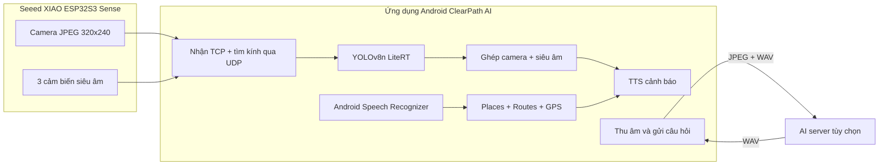
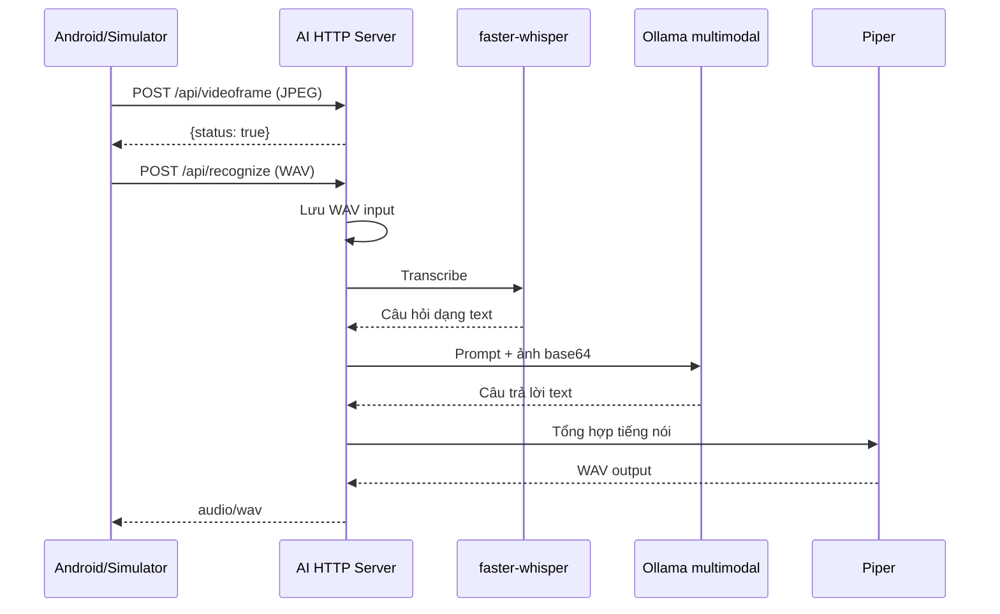
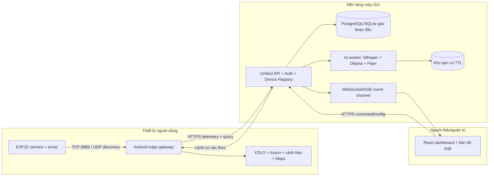

# Báo cáo phân tích và phương án hợp nhất hệ thống BlindAssist

**Ngày phân tích:** 01/11/2026  
**Dự án 1:** `F:\BlindAssistGlasses-Main`  
**Dự án 2:** `F:\BlindAssistDevice`  
**Mục tiêu:** phân tích trạng thái thực tế của hai mã nguồn, xác định cách chúng đang hoạt động, đánh giá khả năng tương thích và đề xuất kiến trúc hợp nhất.

> Báo cáo này được lập từ mã nguồn và cấu hình trong working tree hiện tại. Không có kiểm thử phần cứng ESP32, cảm biến, camera hoặc thử nghiệm người dùng. `BlindAssistDevice` đang có nhiều thay đổi chưa commit, vì vậy kết luận phản ánh working tree hiện tại, không chỉ commit gần nhất.

## 1. Kết luận điều hành

Hai dự án **bổ sung cho nhau**, không phải hai cách triển khai tương đương:

- `BlindAssistGlasses-Main` đã có chuỗi thiết bị gần hoàn chỉnh: ESP32 thu ảnh/khoảng cách, Android nhận dữ liệu, chạy YOLO tại thiết bị, cảnh báo bằng giọng nói, nhận lệnh và điều hướng Google Maps.
- `BlindAssistDevice` cung cấp phần còn thiếu ở phía máy chủ: hỏi đáp ảnh bằng Whisper → mô hình đa phương thức qua Ollama → Piper, cùng dashboard web dành cho người thân/quản trị.
- API hỏi đáp của Android và AI server đã tương thích trực tiếp ở hai endpoint `POST /api/videoframe` và `POST /api/recognize`.
- Dashboard chưa kết nối với ứng dụng Android thật. Dữ liệu GPS hiện đến từ simulator, detections luôn rỗng, pin không có, điều hướng chỉ trả phản hồi demo, nút SOS và nút bắt đầu điều hướng chưa có nghiệp vụ.
- Không nên đưa AI server vào vòng cảnh báo chướng ngại vật. Cảnh báo an toàn phải tiếp tục chạy cục bộ trên Android để vẫn hoạt động khi mất Internet hoặc máy chủ lỗi.
- Không nên chỉ chép hai thư mục vào cùng một repository rồi coi là đã hợp nhất. Việc hợp nhất cần chuẩn hóa vai trò Android, định danh thiết bị, API telemetry, quyền truy cập, lưu trữ dữ liệu và luồng lệnh từ dashboard.

**Kiến trúc đích được khuyến nghị:** ESP32 là cảm biến; Android là edge gateway và bộ điều khiển chính; backend là trung tâm tài khoản, telemetry và lệnh; AI worker xử lý hỏi đáp không thời gian thực; dashboard là giao diện giám sát. Đây là thay đổi ít rủi ro nhất vì tận dụng được phần đã hoạt động của cả hai dự án.

## 2. Phạm vi và phương pháp

Đã đọc và đối chiếu:

- firmware ESP32, giao thức TCP/UDP và công cụ giả lập;
- ứng dụng Android, model LiteRT, logic cảnh báo, lệnh giọng nói, điều hướng và AI client;
- AI server, STT/TTS, Ollama, kho ảnh gần nhất và HTTP server;
- backend vị trí/địa điểm, schema SQLite, dashboard React và hai browser simulator;
- tài liệu giao thức và tài liệu tích hợp hiện có;
- trạng thái Git, cấu hình build và các bài kiểm thử có trong repository.

Đã thực hiện kiểm tra không cần phần cứng:

- 16 tệp Python của `BlindAssistDevice` đều phân tích cú pháp thành công;
- môi trường hiện tại tìm thấy `faster-whisper`, Ollama CLI, Piper CLI và model Piper được hard-code trong cấu hình;
- ESLint của frontend chạy được và báo 3 lỗi trong `Dashboard.jsx`;
- Android có 40 unit test JVM và 2 instrumented test, nhưng không thể chạy tại máy phân tích vì chưa có Android SDK/`local.properties` chỉ ra `sdk.dir`.

Không kiểm tra được độ chính xác YOLO, khoảng cách siêu âm, tốc độ thực tế, độ trễ cảnh báo, Google Maps bằng khóa thật hoặc pipeline AI trên GPU bằng dữ liệu mới.

## 3. Dự án `BlindAssistGlasses-Main`

### 3.1 Vai trò và kiến trúc hiện tại



Điện thoại là bộ xử lý trung tâm. Ngoài nguồn ảnh từ kính, app có thể dùng camera điện thoại để phát triển và kiểm thử mà không cần ESP32.

### 3.2 Firmware và giao thức kính

Firmware chính là [`clearpath_glasses.ino`](../esp32/clearpath_glasses/clearpath_glasses.ino), với cấu hình Wi-Fi trong [`config.h`](../esp32/clearpath_glasses/config.h).

- ESP32 kết nối Wi-Fi 2.4 GHz và mở TCP server cổng `8888`.
- Kính phát UDP beacon `CLEARPATH 8888` đến cổng `8889` để Android tự tìm IP.
- Gói TCP bắt đầu bằng `0xBA 0xC1`, tiếp theo là loại gói, chiều dài `uint32 little-endian` và payload.
- `0x01`: một JPEG hoàn chỉnh; `0x10`: khoảng cách trái/giữa/phải dạng `uint16` cm.
- Firmware đặt mục tiêu 10 FPS; số đo siêu âm được gửi khoảng mỗi 120 ms.
- `0x02` cho camera thứ hai và `0x20`/`0x21` cho audio/nút bấm mới chỉ là thiết kế hoặc phần giữ chỗ, chưa tạo thành luồng hoàn chỉnh trên Android.

Điểm mạnh là giao thức đơn giản, có resync và có simulator. Điểm yếu là không có phiên bản protocol, sequence number, timestamp, checksum hoặc xác thực thiết bị. Những trường này sẽ cần khi có nhiều thiết bị hoặc cần chẩn đoán mất gói/độ trễ.

### 3.3 Android: nhận diện và cảnh báo

Ứng dụng đóng gói `yolov8n.tflite` và dùng LiteRT với CPU. Khung hình được xử lý theo chiến lược giữ ảnh mới nhất để tránh hàng đợi tăng độ trễ.

Luồng cảnh báo:

1. Nhận JPEG từ ESP32 hoặc frame CameraX.
2. Chạy YOLO và hậu xử lý confidence/NMS.
3. Ước lượng khoảng cách đơn ảnh từ kích thước hộp và chiều cao điển hình của lớp vật thể.
4. Ghép với vùng siêu âm trái/giữa/phải; khi hai nguồn lệch, logic thiên về khoảng cách gần hơn để cảnh báo sớm.
5. Lọc theo vùng đường đi và ngưỡng khoảng cách, chống lặp, rồi phát TTS.

Đây là một pipeline nguyên mẫu hợp lý, nhưng khoảng cách camera chỉ là ước lượng, không phải depth đã hiệu chuẩn. Hệ thống cũng chỉ nhận các lớp COCO, nên hố, bậc thềm, mép vỉa hè, cành cây mảnh hoặc vật thể trong suốt có thể bị bỏ sót.

### 3.4 Android: giọng nói và điều hướng

- Lệnh giọng nói dùng Android Speech Recognizer với locale `zh-TW`, không phải Whisper cục bộ.
- Parser nhận các lệnh đi đến địa điểm, tìm nơi gần nhất, dừng, mô tả cảnh, nhắc lại và trợ giúp.
- `MapsClient` gọi Google Places API (New) và Routes API qua HTTPS.
- `Navigator` theo dõi GPS, chuyển bước, phát hiện đến nơi và tính lại khi lệch tuyến.

Điều hướng này đã có logic thật trên điện thoại. Nó không sử dụng backend `BlindAssistDevice`. Khi hợp nhất, Android nên tiếp tục là nơi thực thi tuyến đường; dashboard chỉ gửi yêu cầu đích đến và quan sát trạng thái.

### 3.5 Android: hỏi đáp AI

[`AiServerClient.kt`](../android/app/src/main/java/com/blindassist/app/ask/AiServerClient.kt) đã được viết riêng cho `BlindAssistDevice`:

1. Chụp frame hiện tại và gửi `POST /api/videoframe` với `image/jpeg`.
2. Thu WAV mono 16 kHz trên điện thoại và gửi `POST /api/recognize` với `audio/wav`.
3. Nhận `audio/wav`, phát câu trả lời và hỗ trợ hủy request.

Client có timeout kết nối 4 giây, timeout đọc 90 giây, thông báo lỗi bằng giọng nói và nhắc “đang xử lý” trong lúc chờ. Đây là điểm tích hợp đã hoàn thiện nhất giữa hai repository.

### 3.6 Mức độ sẵn sàng

| Hạng mục | Đánh giá | Nhận xét |
|---|---|---|
| Firmware stream ảnh | Khá | Có mã thật và simulator; cần đo lại trên phần cứng |
| Siêu âm | Trung bình | Có firmware và fusion; tài liệu ghi chưa xác minh đầy đủ trên kính |
| YOLO trên Android | Khá | Model và code đã tích hợp; instrumented test cần Android SDK/thiết bị |
| Cảnh báo TTS | Khá cho nguyên mẫu | Cần nghiên cứu người dùng và kiểm thử latency/false warning |
| Điều hướng | Trung bình–khá | Có API/GPS thật; phụ thuộc khóa Maps, Internet và độ chính xác GPS |
| Hỏi đáp AI | Khá ở phía client | API khớp server; phụ thuộc server GPU/Ollama/Piper |
| Sẵn sàng an toàn | Thấp | Chưa đủ bằng chứng để dùng như thiết bị bảo đảm an toàn |

## 4. Dự án `BlindAssistDevice`

### 4.1 Cấu trúc thực tế

```text
BlindAssistDevice/
├── AiServer/                 # HTTP AI server, Whisper, Ollama, Piper
├── Backend/                  # backend demo vị trí và saved places
├── SharedProtocol/           # tài liệu API còn sơ lược
├── WepApp/Frontend1/         # dashboard React/Vite
├── WepApp/esp-simulator/     # giả lập ESP bằng webcam/micro trình duyệt
├── WepApp/fesimulator/       # giả lập phía xem frame
├── yolov8s.pt                # artifact model, hiện không được code server sử dụng
└── hand_landmarker.task      # artifact model, hiện không được code server sử dụng
```

Tên `WepApp` là lỗi chính tả đã trở thành tên thư mục. Repository không có firmware ESP32 thật; phần “ESP” hiện được mô phỏng bằng trình duyệt. Firmware thực tế nên lấy từ `BlindAssistGlasses-Main`.

### 4.2 AI server cổng 8765

Entry point đang có chức năng đầy đủ nhất là [`AiServer/test.py`](../../BlindAssistDevice/AiServer/test.py), dù tên file dễ bị hiểu nhầm là bài test.

Các endpoint:

| Endpoint | Đầu vào | Đầu ra | Trạng thái |
|---|---|---|---|
| `POST /api/videoframe` | JPEG | JSON `status` | Hoạt động trong mã |
| `GET /api/image` | — | JPEG gần nhất | Hoạt động trong mã |
| `POST /api/recognize` | WAV | WAV trả lời | Pipeline thật đã được viết |

Luồng `/api/recognize`:



Cấu hình hiện tại:

- Whisper `medium`, `cuda`, `float16`, mặc định ngôn ngữ `en`;
- model đa phương thức và URL Ollama lấy từ `.env`;
- Piper gọi CLI và dùng đường dẫn model hard-code trên máy của tác giả;
- timeout gọi Ollama là 180 giây, trong khi Android chỉ đợi 90 giây.

Môi trường hiện tại có đủ executable/package đã nêu, nhưng repository không có `requirements.txt`, `pyproject.toml`, lockfile, Dockerfile hoặc script cài đặt để tái tạo môi trường trên máy khác. `.env.example` ở root đang rỗng, trong khi server yêu cầu các khóa Ollama ngay lúc import module.

### 4.3 Kho frame và vấn đề đồng thời

Server chỉ giữ **một ảnh gần nhất toàn cục trong RAM**. Ảnh được persist xuống `Lastimage.jpg` khi server tắt đúng quy trình, nhưng lúc khởi động lại code không nạp ảnh cũ vào RAM. Request nhận diện đầu tiên sau restart phải gửi frame mới.

Thiết kế “last image toàn cục” chỉ phù hợp demo một thiết bị. Nếu hai người dùng gửi frame xen kẽ, câu hỏi của thiết bị A có thể dùng ảnh của thiết bị B. Đây là rủi ro riêng tư và đúng/sai nghiêm trọng, cần được loại bỏ trước khi hỗ trợ nhiều thiết bị.

### 4.4 Lưu dữ liệu và bảo mật AI server

- Mỗi WAV đầu vào và đầu ra được lưu trong `AiServer/runtime/...` với tên UUID và không có cơ chế xóa tự động.
- Có nhiều WAV runtime hiện hữu, cho thấy pipeline đã từng được chạy, nhưng đây không thay thế kiểm thử có ghi nhận kết quả.
- Frame cuối có thể được ghi xuống đĩa khi shutdown.
- Server lắng nghe `0.0.0.0`, dùng HTTP, CORS `*`, không xác thực, không giới hạn kích thước request và không rate limit.
- Log ghi cả câu hỏi và câu trả lời dạng text.

Với dữ liệu của người khiếm thị, audio, ảnh môi trường và vị trí đều là dữ liệu nhạy cảm. Cấu hình hiện tại chỉ phù hợp mạng phát triển tin cậy, không phù hợp triển khai Internet.

### 4.5 `AiServer/run.py` là nhánh cũ/incomplete

`AiServer/run.py` mở cổng `3012`, dùng route `/mode` và `/conversation`, hard-code thư mục Windows và tạo response không đầy đủ. Nó không khớp Android và không chạy pipeline Whisper/Ollama/Piper. Khi hợp nhất nên:

- chỉ định `AiServer/test.py` là nguồn chức năng hiện tại;
- đổi tên entry point thành `main.py` hoặc `server.py`;
- chuyển `run.py` sang thư mục `legacy/` hoặc xóa sau khi xác nhận không còn người dùng.

### 4.6 Backend dashboard cổng 8787

[`Backend/places_server.py`](../../BlindAssistDevice/Backend/places_server.py) là HTTP server demo, không phải backend sản phẩm.

Nó hỗ trợ:

- `GET /api/status`: trạng thái tổng hợp;
- `GET/POST/DELETE /api/location`: vị trí gần nhất trong RAM;
- `GET/POST/DELETE /api/places`: địa điểm lưu trong JSON;
- `GET /api/objects`: luôn trả mảng rỗng;
- `POST /api/navigation/start`: chỉ xác nhận request và nói rõ không có thiết bị điều hướng kết nối.

Giới hạn:

- chỉ có một `_latest_location` toàn cục, mất khi restart;
- không có `device_id`, tài khoản, phiên đăng nhập hoặc phân quyền;
- ghi JSON không có transaction/lock liên tiến trình;
- không có WebSocket dù frontend có file client WebSocket;
- battery, detections và navigation đều là dữ liệu trống/demo;
- CORS mở toàn bộ và không có xác thực.

`Backend/dbdev.py` chỉ tạo schema SQLite. Hai file đăng nhập/đăng ký đang rỗng, database chưa được backend sử dụng. Cột mật khẩu trong schema là text thông thường; nếu triển khai auth phải lưu password hash bằng thuật toán phù hợp, tuyệt đối không lưu mật khẩu thô.

### 4.7 Dashboard React

Dashboard đang poll `/api/status` mỗi giây và poll `/api/image` khoảng 10 lần/giây. Nó có các khối trạng thái, camera, bản đồ và địa điểm đã lưu.

Phần đang hoạt động ở mức demo:

- hiển thị frame cuối từ AI server, fallback sang ảnh mock;
- hiển thị vị trí backend nhận được;
- thêm/xóa địa điểm trong `savedPlaces.json`;
- hiển thị trạng thái backend online/offline.

Phần chưa hoàn chỉnh:

- bản đồ là ảnh tĩnh với bốn góc tọa độ hard-code, dù package đã có Leaflet/React Leaflet;
- detections luôn rỗng; dòng “Obstacle detected” luôn hiển thị tĩnh;
- nút `Start Navigation` không có handler;
- nút `SOS` không có handler;
- WebSocket client không được sử dụng và server không có `/ws`;
- không có đăng nhập hoặc phân quyền người thân/người dùng;
- frontend lint hiện thất bại với 3 lỗi ở `Dashboard.jsx`: biến `error` không dùng, truy cập `loadDashboard` trước khi khai báo và cảnh báo set state trực tiếp trong effect.

### 4.8 Simulator

- `esp-simulator` dùng webcam trình duyệt, resize JPEG 320×240, gửi frame mỗi 100 ms, thu micro rồi gửi WAV, và có thể POST vị trí giả đến backend.
- `fesimulator` poll ảnh từ AI server và có thể gửi/xóa vị trí thủ công.

Đây là công cụ phát triển hữu ích và nên giữ, nhưng phải đổi tên rõ thành simulator; chúng không chứng minh ESP32 thật đang gửi HTTP hoặc GPS.

## 5. Đối chiếu hai dự án

### 5.1 Các phần tương thích ngay

| Nguồn | Đích | Mức tương thích | Kết luận |
|---|---|---|---|
| Android `sendFrame()` | AI `POST /api/videoframe` | Trực tiếp | Giữ nguyên ở giai đoạn đầu |
| Android `ask()` | AI `POST /api/recognize` | Trực tiếp | Giữ nguyên ở giai đoạn đầu |
| AI `audio/wav` | Android `AnswerPlayer` | Trực tiếp | Giữ nguyên |
| AI `GET /api/image` | Dashboard camera | Trực tiếp | Chỉ là frame gần nhất, chưa phải live stream từ kính |
| ESP32 firmware | Android receiver | Trực tiếp | Là đường phần cứng chính nên giữ |

### 5.2 Các phần không tự kết nối

| Khoảng trống | Hiện trạng | Việc cần làm |
|---|---|---|
| Android → backend telemetry | Chưa có | Gửi GPS, kết nối, pin, sonar, detections, trạng thái điều hướng theo `device_id` |
| Backend → Android command | Chưa có | Kênh lệnh có xác thực cho đích đến/SOS/config; Android xác nhận trước khi thực thi |
| Dashboard live detection | Backend luôn trả `[]` | Nhận summary từ Android; không cần chạy lại YOLO server nếu chỉ để hiển thị |
| Dashboard live frame | Chỉ xem last frame AI | Android relay frame đã giảm tốc/độ phân giải theo chính sách riêng tư |
| Saved places → navigation | Nút chưa nối | Backend lưu địa điểm; dashboard gửi command; Android dùng Maps để lập tuyến |
| Nhiều thiết bị | Trạng thái toàn cục | Mọi API và dữ liệu phải khóa theo `account_id/device_id/session_id` |
| Ngôn ngữ | Android `zh-TW`, Whisper/Piper mặc định English | Cấu hình locale theo hồ sơ thiết bị và chọn model STT/TTS tương ứng |

### 5.3 Xung đột kiến trúc cần quyết định

Tài liệu `BlindAssistDevice` mô tả ESP gửi HTTP trực tiếp đến server. Firmware thật trong `BlindAssistGlasses-Main` lại gửi TCP đến Android, và Android đã chạy inference/điều hướng. Nên chọn mô hình thứ hai:

- ESP32 không phụ thuộc Internet hoặc địa chỉ máy chủ;
- Android đã có quyền, GPS, TTS, Maps và đủ tài nguyên chạy YOLO;
- một thiết bị gateway giúp quản lý retry, auth, nén dữ liệu và chế độ offline;
- tránh cho server hoặc dashboard trở thành điểm lỗi của cảnh báo an toàn.

## 6. Kiến trúc hợp nhất đề xuất



### 6.1 Ranh giới trách nhiệm

**ESP32**

- chụp ảnh, đọc cảm biến, timestamp/sequence và gửi về Android;
- không chứa tài khoản, API key dịch vụ hoặc logic AI server;
- có watchdog và báo trạng thái cảm biến.

**Android**

- nguồn sự thật của trạng thái thiết bị đang hoạt động;
- chạy YOLO, fusion, cảnh báo và điều hướng cục bộ;
- buffer telemetry khi mất mạng và gửi lại có giới hạn;
- đóng gói câu hỏi AI thành một phiên nguyên tử;
- nhận lệnh từ backend nhưng yêu cầu người dùng xác nhận với lệnh nhạy cảm.

**Backend/API**

- tài khoản, thiết bị, saved places, quyền người chăm sóc;
- telemetry theo thiết bị, trạng thái online dựa trên heartbeat;
- phát sự kiện realtime cho dashboard;
- audit log cho lệnh và SOS;
- không quyết định cảnh báo va chạm thời gian thực.

**AI worker**

- STT, suy luận ảnh + câu hỏi, TTS;
- queue/timeout/cancel rõ ràng;
- media tạm có TTL và không log nội dung nhạy cảm mặc định;
- không dùng biến ảnh toàn cục giữa các thiết bị.

**Dashboard**

- bản đồ thật, trạng thái, vị trí, detections tóm tắt, saved places;
- điều khiển chỉ qua backend có xác thực;
- hiển thị độ mới của dữ liệu và trạng thái mất kết nối;
- không giả định “backend online” đồng nghĩa “kính an toàn/đang hoạt động”.

### 6.2 API đích đề xuất

Để tương thích ngược, giữ hai endpoint hiện tại trong giai đoạn chuyển đổi, nhưng thêm API version mới:

| API | Mục đích |
|---|---|
| `POST /v1/devices/{deviceId}/telemetry` | GPS, pin, kết nối kính, sonar summary, navigation state |
| `POST /v1/devices/{deviceId}/detections` | Danh sách detection đã rút gọn, không cần gửi mọi frame |
| `POST /v1/devices/{deviceId}/frames` | Frame dashboard có rate limit và chính sách riêng tư |
| `POST /v1/assist/query` | Một request chứa `device_id`, `session_id`, JPEG và WAV |
| `GET /v1/devices/{deviceId}/events` | SSE/WebSocket cho dashboard |
| `POST /v1/devices/{deviceId}/commands` | Đích đến, yêu cầu tìm thiết bị, cấu hình được phép |
| `POST /v1/devices/{deviceId}/sos` | Sự kiện khẩn cấp có audit và trạng thái xác nhận |

`/v1/assist/query` nên nhận ảnh và audio trong cùng request hoặc cùng `session_id`. Như vậy câu hỏi luôn gắn đúng ảnh và loại bỏ lỗi “last image” khi nhiều người dùng.

Telemetry mẫu:

```json
{
  "sentAt": "2026-11-01T09:30:00+08:00",
  "appVersion": "1.0.0",
  "glassesConnected": true,
  "location": { "lat": 24.990782, "lng": 121.346525, "accuracyM": 8.5 },
  "battery": { "phonePercent": 72, "glassesPercent": null },
  "sonarCm": { "left": null, "center": 86, "right": 143 },
  "navigation": { "state": "active", "destinationName": "Home" }
}
```

Server phải tự lấy `account_id/device_id` từ token hoặc kiểm tra chúng với token, không tin một ID tùy ý do client gửi.

### 6.3 Cấu trúc monorepo đề xuất

```text
BlindAssist/
├── apps/
│   ├── android/             # từ BlindAssistGlasses-Main/android
│   └── dashboard/           # từ BlindAssistDevice/WepApp/Frontend1
├── firmware/
│   └── glasses-esp32/       # firmware chính và simulator protocol
├── services/
│   ├── api/                 # auth, devices, telemetry, places, commands
│   └── ai-worker/           # Whisper, Ollama, Piper
├── packages/
│   └── protocol/            # schema JSON, packet spec, versioning
├── tools/
│   └── simulators/          # fake glasses, esp-simulator, FE simulator
├── docs/
└── infra/                   # env examples, Docker/Compose, reverse proxy
```

Không di chuyển file ngay từ đầu. Trước tiên cần chốt API/schema và có integration test; sau đó mới tái cấu trúc để tránh vừa đổi đường dẫn vừa đổi hành vi.

## 7. Ma trận giữ, sửa, thay thế

| Thành phần | Quyết định | Lý do |
|---|---|---|
| Firmware `clearpath_glasses` | Giữ và nâng cấp | Là firmware thật đầy đủ nhất |
| TCP/UDP Android–ESP | Giữ ở v1, thêm version/sequence/timestamp | Đã tích hợp và phù hợp mạng cục bộ |
| YOLO LiteRT Android | Giữ | Cảnh báo offline và latency thấp |
| Fusion + TTS Android | Giữ, hiệu chuẩn/kiểm thử thêm | Là đường an toàn cốt lõi |
| Google Maps trên Android | Giữ | Logic thực thi đã có trên thiết bị |
| Android AI client | Giữ tương thích, sau đó chuyển API atomic | Khớp AI server hiện tại |
| `AiServer/test.py` | Đổi tên và harden | Là server chức năng hiện tại |
| `AiServer/run.py` | Legacy/loại bỏ | API cũ, incomplete, không tương thích |
| Global last image | Thay thế | Không an toàn cho nhiều thiết bị |
| Backend `places_server.py` | Dùng làm prototype, rồi thay | Thiếu auth, persistence chuẩn và realtime |
| JSON saved places | Migrate vào DB | Cần tài khoản, đồng thời và audit |
| React dashboard | Giữ UI, sửa data layer/map/auth | Có nền tảng hiển thị nhưng nhiều phần demo |
| Static map | Thay bằng Leaflet/nhà cung cấp bản đồ | Tọa độ hard-code không dùng được ngoài vùng demo |
| WebSocket client hiện tại | Hoàn thiện hoặc bỏ | Hiện không có server và không được dùng |
| `yolov8s.pt`, `hand_landmarker.task` ở server | Đánh giá rồi xóa/đưa vào registry | Hiện không có code sử dụng |
| Browser simulators | Giữ | Hữu ích cho integration test |

## 8. Rủi ro ưu tiên

| Mức | Rủi ro | Ảnh hưởng | Hành động bắt buộc trước pilot |
|---|---|---|---|
| P0 | Khoảng cách camera chưa hiệu chuẩn, lớp nhận diện không bao phủ mọi nguy hiểm | Cảnh báo sai hoặc bỏ sót | Test phần cứng, calibration, kịch bản thực địa, luôn công bố giới hạn |
| P0 | HTTP không auth/CORS `*` cho ảnh, audio, vị trí và lệnh | Rò rỉ dữ liệu/điều khiển trái phép | HTTPS, token theo thiết bị, RBAC, CORS allowlist |
| P0 | Global last image/location | Trộn dữ liệu giữa người dùng | Partition theo device/session; query atomic |
| P0 | WAV được giữ vô thời hạn | Rủi ro riêng tư | TTL, xóa sau response, consent và retention policy |
| P1 | Dashboard không nhận telemetry thật | Giao diện tạo cảm giác hoạt động giả | Android telemetry service + trạng thái freshness |
| P1 | Server không giới hạn payload/rate | Cạn RAM/đĩa, từ chối dịch vụ | Max body, rate limit, quota, timeout và backpressure |
| P1 | Timeout Android 90 s < Ollama 180 s | Client bỏ cuộc khi server vẫn chạy | Chốt SLA, queue/cancel, đồng bộ timeout |
| P1 | Cấu hình ngôn ngữ không thống nhất | STT/TTS sai ngôn ngữ | Locale theo profile; model tương ứng |
| P1 | Không có dependency manifest/deployment | Không tái lập được môi trường | Lock dependency, `.env.example`, container hoặc installer |
| P1 | Không có test tự động cho `BlindAssistDevice` | Regression cao | Unit/API/integration/concurrency tests |
| P2 | Dead code và hai entry point server | Khởi động nhầm dịch vụ | Chuẩn hóa một entry point và lệnh chạy |
| P2 | Model artifact không được dùng | Tăng kích thước và gây nhầm lẫn | Model registry/checksum hoặc loại bỏ |

## 9. Lộ trình hợp nhất đề xuất

### Giai đoạn 0 — Chốt hợp đồng và tiêu chí

- Chọn locale sản phẩm và chiến lược đa ngôn ngữ.
- Định nghĩa `device_id`, `session_id`, timestamp và version.
- Chốt dữ liệu nào được gửi lên server, tần suất và thời gian lưu.
- Đóng băng hai API hỏi đáp hiện tại làm baseline tương thích.

### Giai đoạn 1 — Làm sạch và tái lập AI server

- Đổi `AiServer/test.py` thành entry point chính.
- Tạo dependency lock, `.env.example` đầy đủ và cấu hình model không hard-code.
- Đồng bộ timeout, thêm max body, health/readiness endpoint và structured error.
- Xóa WAV/frame theo TTL; tắt log nội dung câu hỏi mặc định.
- Viết test cho content type, empty body, thiếu frame, lỗi Ollama, lỗi STT/TTS và cancel.

### Giai đoạn 2 — Nối Android với backend

- Thêm background telemetry publisher có retry/backoff và giới hạn pin/mạng.
- Gửi GPS, trạng thái kính, navigation state và detection summary.
- Thêm xác thực thiết bị và certificate/HTTPS.
- Giữ toàn bộ cảnh báo cục bộ khi backend không khả dụng.

### Giai đoạn 3 — Nâng backend và dashboard

- Thay state toàn cục/JSON bằng DB theo account/device.
- Triển khai đăng nhập, người chăm sóc, RBAC và audit.
- Dùng Leaflet thật; hiển thị `lastSeen`, độ chính xác GPS và dữ liệu quá hạn.
- Hoàn thiện event channel; bỏ file WebSocket không dùng nếu chọn SSE.
- Nối saved place → command → Android → trạng thái điều hướng.

### Giai đoạn 4 — API hỏi đáp nhiều thiết bị

- Chuyển từ hai request dựa vào global last frame sang query atomic.
- Thêm queue, concurrency limit và cancel propagation đến Ollama/Piper.
- Test hai thiết bị gửi xen kẽ để chứng minh không trộn ảnh/audio.
- Giữ adapter `/api/videoframe` và `/api/recognize` cho app cũ trong thời gian migration.

### Giai đoạn 5 — Monorepo và CI

- Sau khi contract ổn định, di chuyển mã vào cấu trúc `apps/services/firmware`.
- CI chạy Kotlin unit tests, Android lint/build, Python tests/type/lint, frontend lint/build và contract tests.
- Tạo simulator test end-to-end: fake glasses → Android hoặc gateway test double → API → dashboard/AI.
- Tạo versioned release và migration guide thay vì phụ thuộc working tree.

### Giai đoạn 6 — Xác minh thiết bị và pilot

- Đo FPS, độ trễ inference, độ trễ cảnh báo và mất gói trên phần cứng thật.
- Test ánh sáng yếu, ngoài trời, vật thể tĩnh/di động, nhiều bề mặt và nhiễu siêu âm.
- Test mất Wi-Fi, mất Internet, AI server down, GPS drift và pin yếu.
- Thực hiện đánh giá accessibility và pilot có giám sát với người dùng mục tiêu.
- Xác định rõ hệ thống hỗ trợ, không thay thế gậy trắng/chó dẫn đường hoặc kỹ năng định hướng.

## 10. Tiêu chí nghiệm thu tối thiểu

### Đường an toàn cục bộ

- Mất backend/Internet không làm dừng YOLO, sonar fusion hoặc cảnh báo TTS.
- Có chỉ báo bằng âm thanh khi mất kết nối kính hoặc sensor không hợp lệ.
- Độ trễ cảnh báo, false positive và false negative được đo theo bộ kịch bản đã thống nhất.
- Khoảng cách được hiệu chuẩn theo camera, góc lắp và phần cứng thực tế.

### AI hỏi đáp

- Ảnh và audio của hai thiết bị đồng thời không bao giờ bị trộn.
- Request có thể hủy; file tạm bị xóa theo TTL kể cả khi lỗi.
- Timeout client/server nhất quán và trả mã lỗi có thể đọc bằng TTS.
- Ngôn ngữ STT/TTS đúng với cấu hình người dùng.

### Dashboard

- Mỗi thiết bị có `lastSeen`; dữ liệu cũ được hiển thị là cũ, không phải online.
- Bản đồ dùng tọa độ thật và không phụ thuộc ảnh/tọa độ hard-code.
- Lệnh điều hướng có audit, trạng thái accepted/delivered/confirmed/rejected.
- SOS có định nghĩa nghiệp vụ, người nhận, retry và xác nhận; không để nút trang trí trong bản phát hành.

### Bảo mật và dữ liệu

- Mọi API ngoài môi trường local dùng HTTPS và xác thực.
- Người chăm sóc chỉ thấy thiết bị được cấp quyền.
- Có retention policy, chức năng xóa và log không chứa media/text nhạy cảm mặc định.
- Secret không nằm trong source, APK, frontend bundle hoặc tài liệu commit.

## 11. Kết quả kiểm tra mã nguồn trong lần phân tích

| Kiểm tra | Kết quả |
|---|---|
| Python syntax, 16 file | Đạt |
| `faster-whisper` trong môi trường | Có |
| Ollama CLI | Có |
| Piper CLI và model cấu hình hiện tại | Có |
| Frontend ESLint | Không đạt: 3 lỗi trong `Dashboard.jsx` |
| Android unit test | Chưa chạy được: thiếu Android SDK/`sdk.dir` |
| Android test hiện diện | 40 JVM unit tests + 2 instrumented tests |
| Firmware/phần cứng | Chưa kiểm tra |
| AI end-to-end với request mới | Chưa chạy trong lần phân tích |

Việc “có dependency/model trên máy” chỉ chứng minh môi trường có thành phần cần thiết, không chứng minh pipeline trả lời đúng hoặc đạt hiệu năng yêu cầu.

## 12. Kết luận cuối cùng

Hai dự án có thể hợp nhất với chi phí hợp lý vì giao điểm quan trọng nhất — Android hỏi AI server bằng JPEG + WAV và nhận WAV — đã tương thích. Phần nên giữ nguyên nhiều nhất là firmware/Android của `BlindAssistGlasses-Main` và pipeline Whisper/Ollama/Piper của `BlindAssistDevice`.

Phần cần đầu tư lớn nhất không phải nhận diện AI mà là **lớp nền tảng**: định danh thiết bị, telemetry, backend nhiều người dùng, auth, dữ liệu realtime, privacy và test. Dashboard hiện là bản demo trực quan; chưa phải hệ thống giám sát kính thật. AI server chạy theo mô hình một thiết bị và lưu dữ liệu nhạy cảm lâu dài; chưa phù hợp production.

Thứ tự đúng là: chuẩn hóa contract → làm cứng AI server → nối telemetry Android → hoàn thiện backend/dashboard → chuyển query thành phiên nguyên tử → mới tái cấu trúc monorepo và pilot. Trong toàn bộ quá trình, đường cảnh báo chướng ngại vật và điều hướng cơ bản phải tiếp tục hoạt động tại Android, độc lập với server.
