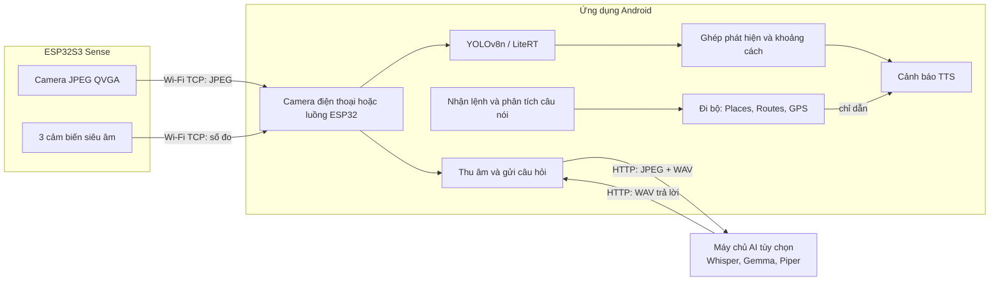

# Báo cáo phân tích dự án BlindAssistGlasses

**Ngày:** 31/10/2026  
**Phạm vi:** Đọc mã nguồn, cấu hình và tài liệu trong repository này. Báo cáo không bao gồm kiểm thử thiết bị hoặc xác nhận phần cứng đang hoạt động.

## 1. Tóm tắt

BlindAssistGlasses là nguyên mẫu kính hỗ trợ người khiếm thị. Firmware trên Seeed XIAO ESP32S3 Sense gửi ảnh camera và số đo ba cảm biến siêu âm đến ứng dụng Android qua Wi-Fi. Điện thoại là bộ xử lý trung tâm: chạy nhận diện vật thể YOLOv8n bằng LiteRT, kết hợp khoảng cách để phát cảnh báo bằng Text-to-Speech (TTS), nhận lệnh giọng nói và điều hướng đi bộ bằng Google Maps Platform.

Ứng dụng còn có luồng hỏi đáp bằng giọng nói về khung hình hiện tại. Luồng này gửi ảnh và bản ghi âm đến máy chủ AI bên ngoài repository; máy chủ có thể thực hiện Whisper, Gemma và Piper rồi trả lời bằng âm thanh. Đây không phải mô hình LLM chạy cục bộ trên điện thoại.

## 2. Sơ đồ kiến trúc

Điện thoại cũng có thể dùng camera sau làm nguồn ảnh thử nghiệm, không cần ESP32. Lựa chọn nguồn ảnh được lưu trong cài đặt ứng dụng.

## 3. Các luồng hoạt động chính

### 3.1 Nhận ảnh và số đo từ kính

Firmware chính nằm ở [`esp32/clearpath_glasses/clearpath_glasses.ino`](../esp32/clearpath_glasses/clearpath_glasses.ino), cấu hình ở [`config.h`](../esp32/clearpath_glasses/config.h). ESP32 kết nối Wi-Fi 2.4 GHz, mở TCP server cổng 8888 và gửi beacon UDP `CLEARPATH 8888` qua cổng 8889 để điện thoại tìm địa chỉ kính. Điện thoại có thể bỏ trống IP để tự tìm hoặc nhập IP thủ công.

Mỗi gói TCP có magic bytes `0xBA 0xC1`, loại gói, độ dài payload 32-bit little-endian và dữ liệu. Loại `0x01` mang JPEG 320×240; `0x10` mang các số đo siêu âm 16-bit theo thứ tự trái, giữa, phải. Firmware đặt mục tiêu 10 khung hình/giây và gửi số đo định kỳ 120 ms. Bộ nhận Android giải mã gói, bỏ qua loại chưa hỗ trợ và tự kết nối lại sau khi đường truyền lỗi. Loại ảnh thứ hai `0x02` chỉ được dành chỗ trong giao thức, chưa được xử lý như nguồn ảnh stereo.

Khi dùng camera điện thoại, CameraX giữ khung hình mới nhất thay vì xếp hàng ảnh cũ. Bộ giám sát cũng dùng một luồng xử lý YOLO riêng và chỉ giữ ảnh đang chờ mới nhất để giảm độ trễ.

### 3.2 Nhận diện và cảnh báo chướng ngại vật

Model `yolov8n.tflite` được đóng gói trong ứng dụng và chạy trên điện thoại bằng LiteRT với bốn luồng CPU. Bộ xử lý hậu kỳ chọn điểm cao nhất theo lớp, lọc ở ngưỡng 0,35, áp dụng non-maximum suppression với IoU 0,45 và giữ tối đa 20 vật thể. Nhãn dựa trên các lớp COCO.

`ObstacleFuser` ước tính khoảng cách ảnh đơn bằng chiều cao điển hình của lớp vật thể, chiều cao hộp nhận diện và góc nhìn camera. Nếu có cảm biến siêu âm ở vùng tương ứng, thuật toán dùng số đo siêu âm khi hai nguồn gần nhau; khi lệch đáng kể, chọn khoảng cách gần hơn để thiên về cảnh báo sớm. Cảm biến siêu âm cũng có thể tạo cảnh báo không nhãn cho vật thể gần mà camera không nhận diện được. Nếu cảnh tối, ứng dụng hạ mức tin cậy khi đặt tên vật thể; số đo siêu âm vẫn có thể dùng được.

`ObstacleAnnouncer` chỉ cảnh báo vật thể trong phạm vi 4 m và trên đường đi dự kiến; vật thể hai bên chỉ được tính khi gần hơn 1,2 m. Vật thể dưới 1 m nhận cảnh báo ưu tiên cao. Bộ phát ngôn giảm lặp lại cảnh báo, còn chế độ mô tả cảnh giữ lại phát hiện không rỗng gần nhất tối đa một giây để giảm ảnh hưởng của nhận diện chập chờn.

### 3.3 Lệnh giọng nói và điều hướng

`VoiceCommandListener` dùng dịch vụ nhận dạng giọng nói có sẵn trên Android, đặt ngôn ngữ `zh-TW`; đây chưa phải Whisper chạy trong ứng dụng. Một số lỗi tạm thời được tự thử lại tối đa hai lần. `CommandParser` nhận các lệnh tiếng Hoa phồn thể/giản thể như đi đến địa điểm, dừng dẫn đường, mô tả cảnh, nhắc lại và trợ giúp.

Khi cần đi đến địa điểm, `MapsClient` gọi Places API (New) để tìm nơi cần đến và Routes API với chế độ đi bộ để lấy các chặng. `Navigator` theo dõi GPS độ chính xác cao, đọc chỉ dẫn qua TTS, phát hiện lệch đường và yêu cầu tính lại. Mã đặt ngưỡng tiến sang chặng kế tiếp khoảng 12 m, đến nơi khoảng 15 m, và xác nhận lệch đường khi cách tuyến trên 40 m trong ba lần cập nhật liên tiếp. Chức năng này cần quyền vị trí, kết nối Internet và khóa API đã cấu hình.

### 3.4 Hỏi đáp về hình ảnh

Người dùng nhấn nút hỏi, nghe tiếng bíp rồi nói vào micro điện thoại. `QuestionRecorder` thu âm mono 16 kHz, PCM 16-bit; tự dừng sau khoảng một giây im lặng, khi không có tiếng nói hoặc đến giới hạn khoảng bảy giây. Người dùng cũng có thể dừng sớm bằng cách nhấn lại nút.

Ứng dụng gửi khung hình JPEG hiện tại đến `POST /api/videoframe`, sau đó gửi WAV đến `POST /api/recognize`. Máy chủ trả về WAV để Android phát. Kết nối có thời hạn chờ đọc 90 giây, có thể hủy khi người dùng dừng hoặc rời ứng dụng, và ứng dụng đọc thông báo lỗi bằng giọng nói. Địa chỉ máy chủ lấy từ `AI_SERVER_URL` trong `android/local.properties` hoặc nhập bằng cách nhấn giữ nút hỏi. Mặc định là cổng 8765.

[`tools/mock_ai_server.py`](../tools/mock_ai_server.py) mô phỏng API này để phát triển không cần GPU; máy chủ giả lưu âm thanh và hình nhận được vào `mock_ai_output/` và trả tiếng chuông hoặc WAV người dùng chỉ định. Nó không thực hiện nhận diện hay trả lời bằng AI thật.

## 4. Thành phần và cấu hình quan trọng

| Thành phần | Vai trò |
|---|---|
| `esp32/clearpath_glasses/` | Firmware camera, Wi-Fi và ba cảm biến siêu âm |
| `android/app/src/main/java/.../camera/` | CameraX, tìm ESP32, giải mã giao thức TCP |
| `.../detect/` | LiteRT, hậu xử lý YOLO và nhãn COCO |
| `.../guide/` | Ghép khoảng cách, chống chập chờn và phát cảnh báo |
| `.../speech/` | TTS, nhận lệnh và phân tích câu lệnh |
| `.../nav/` | Places, Routes, xử lý tọa độ và tiến độ tuyến đường |
| `.../ask/` | Thu âm, mã hóa WAV, gửi HTTP và phát âm thanh trả lời |
| `docs/` | Giao thức ESP32, hướng dẫn app và tích hợp máy chủ AI |

Ứng dụng Android khai báo `minSdk 26`, `targetSdk 37`; khóa Maps và địa chỉ AI mặc định đọc từ `android/local.properties`. ESP32 yêu cầu cấu hình tên/mật khẩu Wi-Fi riêng và PSRAM OPI cho camera. Nếu dùng Android 17 với target SDK hiện tại, ứng dụng yêu cầu quyền truy cập mạng nội bộ lúc chạy.

## 5. Trạng thái và giới hạn

**Đã có trong mã nguồn:** firmware stream ảnh và số đo; nguồn camera điện thoại để thử; model YOLO tích hợp; logic cảnh báo; TTS; lệnh giọng nói; điều hướng Google Maps; luồng hỏi đáp qua API HTTP; máy chủ giả để phát triển. README báo cáo đã đo được khoảng 10,1 FPS cho đường truyền, nhưng con số này không được xác minh lại trong lần phân tích.

**Còn phụ thuộc hoặc đang để ngỏ:** tài liệu ghi nhận cảm biến siêu âm chưa được xác minh đầy đủ trên phần cứng; luồng hỏi đáp chưa được thử với máy chủ GPU thật Whisper/Gemma/Piper; Gemma chưa chạy cục bộ trên điện thoại; micro tích hợp trên kính và gói âm thanh/nhấn nút `0x20`/`0x21` chưa được triển khai trong app; stereo cần thêm camera/phần cứng; ứng dụng không có mô hình chuyên biệt cho hố, vỉa hè hoặc chướng ngại vật ngoài bộ lớp COCO.

**Giới hạn độ tin cậy:** khoảng cách từ camera là ước lượng đơn ảnh dựa trên kích thước vật thể điển hình, không phải phép đo chiều sâu đã hiệu chuẩn. Kết quả phụ thuộc góc lắp camera, loại vật thể, ánh sáng và môi trường. Cảnh báo cũng phụ thuộc vật thể được cảm biến nhìn thấy. Vì vậy không nên xem nguyên mẫu này là phương tiện bảo đảm an toàn hoặc thay thế gậy/trợ giúp định hướng đã được kiểm chứng.

**Mạng và dữ liệu:** cấu hình Android cho phép HTTP không mã hóa ở mức toàn ứng dụng; lời gọi Google Maps dùng HTTPS. API máy chủ không có xác thực theo tài liệu tích hợp. Ảnh hiện tại và bản ghi âm được gửi ra khỏi điện thoại khi hỏi AI; máy chủ giả lưu các tệp nhận được. Tài liệu tích hợp ghi nhận máy chủ thật hiện giữ lại âm thanh đầu vào và đầu ra, đồng thời đề xuất bản vá xóa sau mỗi yêu cầu; mã máy chủ và việc áp dụng bản vá nằm ngoài repository này, nên cần kiểm tra chính sách lưu trữ thực tế tại đó.

## 6. Kiểm thử và cách hiểu kết quả

Repository có các bộ kiểm thử JVM cho phân tích câu lệnh, giao thức, điều hướng, logic chướng ngại vật, nhận diện gần đây, xử lý hỏi đáp và chính sách thử lại giọng nói; có thêm kiểm thử Android cho detector. Tài liệu tích hợp mô tả việc app đã được thử trên emulator Android 17 với máy chủ giả và mô hình giả. Trong lần phân tích này, tôi chỉ đọc mã và tài liệu, không chạy build, kiểm thử hay phần cứng; vì vậy các mô tả kiểm thử trước đó chưa được xác nhận độc lập.

## 7. Kết luận

Dự án đã hình thành một kiến trúc nguyên mẫu tương đối rõ: ESP32 làm thiết bị thu thập, Android làm bộ xử lý và giao diện âm thanh, dịch vụ AI ngoài là phần mở rộng cho hỏi đáp đa phương thức. Các luồng nhận diện, cảnh báo, lệnh giọng nói và dẫn đường được thể hiện trong mã. Mức độ sẵn sàng thực tế vẫn phụ thuộc vào xác nhận cảm biến trên kính, cấu hình Maps, kiểm tra trên thiết bị thật và hoàn thiện máy chủ AI/ngôn ngữ. Rủi ro lớn nhất về chức năng là độ chính xác của ước lượng khoảng cách và độ phủ nhận diện; rủi ro dữ liệu chính là truyền ảnh/giọng nói qua HTTP không xác thực tới máy chủ hỏi đáp.
